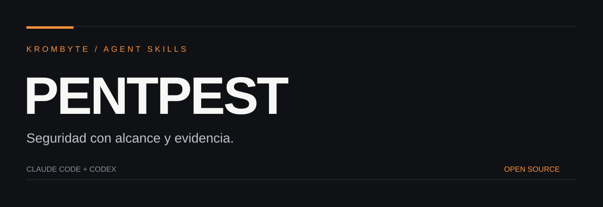

<p align="center"></p>

<p align="center"><strong>Auditoría web autorizada, revisión de código y validación reproducible.</strong><br>Una skill portable, recursos bajo demanda y resultados verificables.</p>

<p align="center">Claude Code · Codex · Agent Skills · MIT</p>

## Qué hace

Delimita alcance · Revisa capacidades · Investiga · Reproduce · Corrige.

## Instalar en Claude Code

En Claude Code:

```text
/plugin marketplace add AlexaDetalles/pentpest-skill
/plugin install pentpest@pentpest-skills
```

Invocar la skill del plugin con `/pentpest:pentpest`. También puedes copiar solamente `skills/pentpest/` a `~/.claude/skills/pentpest/` para usar `/pentpest` sin plugin.

## Instalar en Codex

Desde una carpeta de trabajo, clona el repositorio y copia la skill al directorio de skills personales. Ejemplo PowerShell:

```powershell
git clone https://github.com/AlexaDetalles/pentpest-skill.git
New-Item -ItemType Directory -Force "$HOME/.agents/skills" | Out-Null
Copy-Item -Recurse "./pentpest-skill/skills/pentpest" "$HOME/.agents/skills/pentpest"
```

Si ya existe una instalación, revísala o respáldala antes de reemplazarla. Usa `$pentpest` en Codex. En versiones que utilicen otra carpeta de skills, copia el mismo directorio al destino configurado por tu instalación.

## Un ejemplo

```text
Revisa el código local de esta API y documenta problemas de autorización con evidencia. No hagas peticiones externas.
```

## Qué contiene

| Ruta | Propósito |
|---|---|
| `skills/pentpest/SKILL.md` | Instrucciones portables |
| `skills/pentpest/agents/openai.yaml` | Metadatos de Codex |
| `.claude-plugin/` | Plugin y catálogo para Claude Code |
| `LICENSE` y `NOTICE.md` | Condiciones y procedencia |
| `docs/` | Identidad visual del repositorio |

## Requisitos y límites

Python 3.10+ para utilidades incluidas. Las herramientas de seguridad y servidores MCP son opcionales y se comprueban antes de usarse. La fuente upstream se conserva comprimida y fijada a un commit; sus hooks e instaladores no se activan al instalar esta skill.

La compatibilidad estructural se comprueba localmente; la carga real debe verificarse en cada cliente. No se promete acceso a herramientas ausentes, ahorro medido de tokens ni resultados infalibles.

## Contribuir

Consulta [CONTRIBUTING.md](CONTRIBUTING.md). Para información sensible, consulta [SECURITY.md](SECURITY.md).

## Licencia y créditos

MIT para las aportaciones originales de Isaac / KROMBYTE. Consulta [NOTICE.md](NOTICE.md) para procedencia y condiciones de material externo. Proyecto independiente, sin afiliación con Anthropic u OpenAI.
